<!-- ===================== HEADER ===================== -->

  

<!-- Edit the roles in "lines=" (use + for spaces, ; between roles) -->

  

<!-- ===================== SOCIAL BADGES ===================== -->

  
  
  
  

  

<!-- ===================== ABOUT ME ===================== -->
## 👋 About Me

Final year Electronics student who enjoys building ML models and full-stack web apps. Solving technical problems has intrigued me from a young age.

🔭 **Building right now:** I am building a full stack project NeetDesk which will help me manage my schedule along with my friends.

⚡ **Known for:** Building ML models and implementing it on full stack projects.

<!-- ===================== OPEN SOURCE ===================== -->
## 🌱 Open Source

I fix bugs in AI and cloud-native projects. Right now: Kubeflow Spark Operator, KubeVela and the A2A Python SDK.

  

<!-- The list below and the pet are updated every 6 hours by .github/workflows/profile.yml. Don't edit between the markers. -->
<!-- PRS:START -->
**1 merged** across 1 project · **4 in review**

**Recently merged**

- [lingdojo/kana-dojo#16765](https://github.com/lingdojo/kana-dojo/pull/16765) content: add video game quote · merged 2026-05-13

**In review**

- [a2aproject/a2a-python#1476](https://github.com/a2aproject/a2a-python/pull/1476) fix(client): map JSON-RPC error bodies sent with a non-2xx HTTP status · opened 2026-11-15
- [kubevela/kubevela#7573](https://github.com/kubevela/kubevela/pull/7573) Fix(multicluster): count control-plane nodes on Kubernetes 1.24+ · opened 2026-11-15
- [kubevela/kubevela#7572](https://github.com/kubevela/kubevela/pull/7572) Fix(defkit): stop CUEGenerator leaking detected imports between Generate\* calls · opened 2026-11-15
- [kubeflow/spark-operator#3311](https://github.com/kubeflow/spark-operator/pull/3311) fix(controller): pass message format as the event note, not the action · opened 2026-11-15
<!-- PRS:END -->

<!-- ===================== TECH STACK ===================== -->
## 🛠️ Tech Stack

<!-- Icon IDs: https://skillicons.dev  — e.g. react,nextjs,tailwind,nodejs,express,mongodb,mysql,postgres,docker,aws,git,linux,vscode,figma,tensorflow,pytorch -->

**Languages**

  
  <!-- add more, e.g. ,cpp,java -->

**Frontend**

  

**Backend**

  

**Databases**

  

**Tools & ML**

  

<!-- ===================== PROJECTS ===================== -->
## 🚀 Featured Projects

| Project | Stack | Highlight |
|:--|:--|:--|
| [MRI Knee Ligament Tear Prediction](https://github.com/ArnabDutta01/MRI-knee-ligament-tear-prediction) | Python · PyTorch, Torchvision · EfficientNet-B0 · Scikit-learn · OpenCV ·  Matplotlib · Git LFS | Achieved 0.941 AUC on the Stanford MRNet benchmark |
| [realtime_colab](https://github.com/ArnabDutta01/realtime_colab) | TypeScript · React · Node.js · WebSockets (uWebSockets.js) · Yjs (CRDT) · Redis · PostgreSQL | Engineered a Google Docs-style collaborative editor|
| [Supply_Sense_Carbon_Emission](https://github.com/ArnabDutta01/Supply-Sense-Carbon-Emission) | Python · JavaScript · React · Node.js · Express.js · MongoDB · REST APIs · Data Analytics | Developed Python analytics for automated carbon hotspot detection |

<!-- ===================== GITHUB METRICS ===================== -->
## 📊 GitHub Metrics

<!-- Generated daily by .github/workflows/metrics.yml (lowlighter/metrics) -->

  

<!-- ===================== FOOTER ===================== -->

<i>Thanks for stopping by. Always happy to talk about any technical problems.</i>

